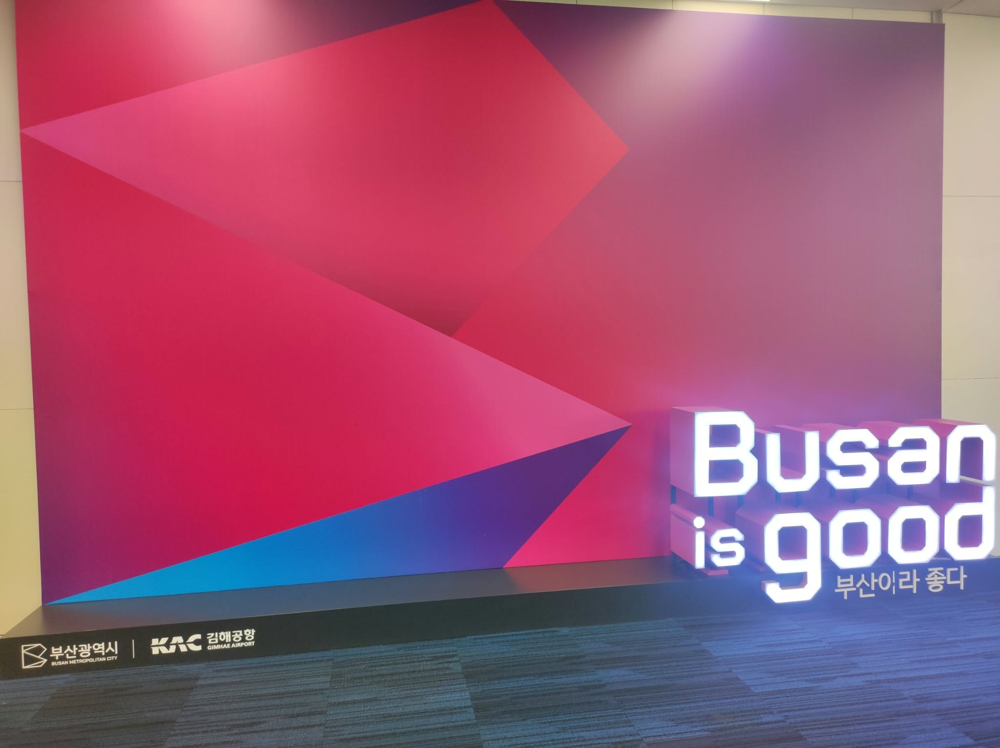
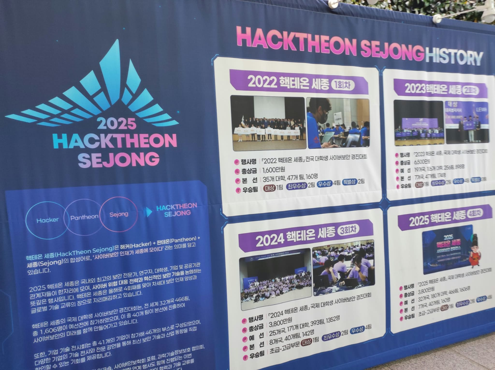
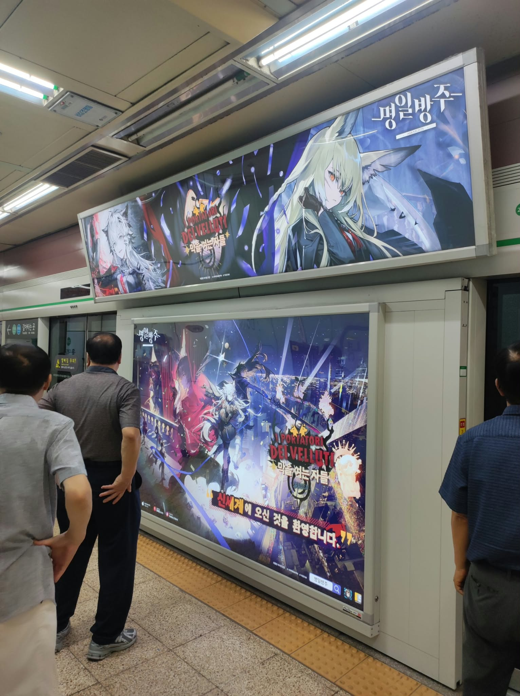

# Hacktheon Sejong 2025

My second time in Korea! The last time I was here was for HackTheon Sejong 2024.

<!--more-->
## Setting

This year, I played as **Chicken Hunter** team in the Advanced Category. I didn't expect to be back at HackTheon, but here I am!

## Arriving in Korea

This year, I decided to make an unconventional move by flying to Busan and taking the train to Sejong, since flights to Busan were much cheaper. I regret not arriving in Busan two days earlier to join the CODEGATE team.

The accommodation was pretty much the same as last year, but I felt like the room was smaller and didn't have a city view. Or maybe I was just unlucky this time, lol.

## The competition day

The good old convention center! I really love how they organize the event, but why is our T-shirt still pink when the staff get to rock that hard-drip black version?

The event showcased the history of the competition. It was really fun to spot myself in the pictures and see how far the event has come.

I was so focused on the competition that I forgot to take any decent pictures. The Advanced Category was definitely tough, but I'm proud that we put up a really good fight against Korean giants like KAIST.

## The ceremony day

I won the lucky draw and got a **Galaxy Watch**, hehe.

## Traveling

After parting ways with the others in Sejong, we finally met up with the CODEGATE team in Seoul for the rest of the trip. We visited **LoL Park** this year, but it wasn't really my thing, so I headed off to buy some souvenirs for my family instead.

After visiting LoL Park, we headed straight to **AK Plaza Hongdae**, which was the best place for anime merchandise. On the way there, I spotted an advertisement featuring Texas, my favorite *Arknights* character.

We also visited Namsan Seoul Tower. This year, I finally got to see it during the day. The view of the city from up there was majestic. On the way down, one guy lost his card, and his phone had died, so we all had to wait for about three hours.

## Going home

Yeah, and that was it for this year's trip. I really enjoyed it, but I also had a few regrets, like not going to Busan earlier. This trip has really motivated me to keep competing in onsite CTF events!
